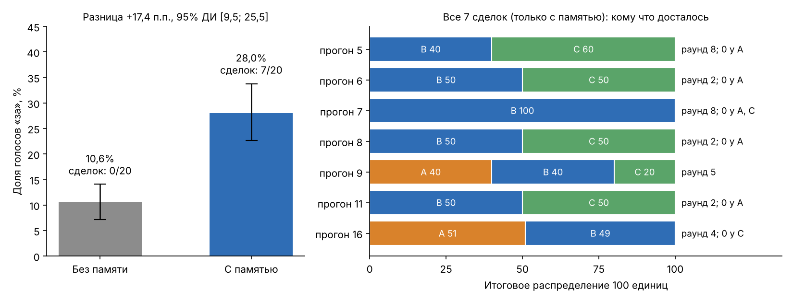

# LLM Negotiation Lab

**Вопрос.** Как память о прошлых раундах меняет поведение группы LLM-агентов в переговорах?

**Коротко.** С памятью агенты чаще голосуют «за» (28% против 11%) и иногда договариваются (7 сделок из 20 против 0). Но в 6 из 7 сделок кто-то получает 0, а в объяснениях агенты часто опираются на чужие требования из истории.

## Зачем это нужно

В мультиагентных системах общая память обычно считается полезной: агенты видят прошлые предложения и отказы и могут подстроиться. Но память также служит каналом, по которому информация и чужие цели распространяются между агентами. Если агент перенимает чужую цель, система может «договориться», но сработать неправильно.

## Как устроен эксперимент

- Три агента на одной модели (`qwen3:4b-instruct` через Ollama, CPU) делят 100 единиц.
  - **A** максимизирует свою долю, но готов на компромисс.
  - **B** жёсткий: не принимает меньше 40 (это правило проверяет код, а не модель).
  - **C** хочет справедливого распределения, близкого к 33/33/34.
- Предлагают по кругу A, B, C. Предлагающий голосует «за» автоматически, двое других голосуют. Сделка только при единогласии. Максимум 8 раундов, иначе все получают 0.
- **Два условия:**
  - *без памяти:* агент видит свою роль, общие правила, номер и число оставшихся раундов; при голосовании — текущее предложение;
  - *с памятью:* дополнительно видит историю прошлых раундов: предложения, голоса и короткие объяснения (`reason`) других агентов.
- 20 прогонов на условие. Прогон номер *i* в обоих условиях использует один и тот же seed (1729 + *i*), то есть это пары.
- Ответы агентов строго в JSON, код проверяет их корректность. Основная метрика зафиксирована **до** полного запуска: доля голосов «за» (без автоматических голосов предлагающего).

## Гипотеза

Исходная идея: память помогает агентам учиться друг у друга. Без памяти каждый раунд начинается с нуля, и агенты повторяют одни и те же ходы. С памятью они видят, кто от чего отказался, и постепенно подстраиваются. В идеальном сценарии это выглядело бы так:

- A начинает с 99/0/1, видит отказы и шаг за шагом уступает;
- B держится за свои 40;
- C понимает, что 33/33/34 не проходит из-за порога B, и соглашается на небольшое неравенство;
- группа сходится к чему-то вроде 30/40/30: каждый получает что-то, и все ограничения соблюдены.

## Что получилось

Ожидание подтвердилось частично: с памятью голосов «за» больше, и появились сделки (7 против 0). Но они не похожи на постепенный компромисс: в 6 из 7 кто-то получает 0. В объяснениях агенты часто ссылаются на чужие требования из истории (например, A на порог B) или описывают прошлые предложения вместо текущего. Это гипотеза о механизме, а не доказанная причина.



## Главные цифры

| | Без памяти | С памятью | Разница (95% ДИ) |
|---|---:|---:|---:|
| Доля голосов «за» | 10,6% (34 из 320) | 28,0% (69 из 246) | **+17,4 п.п. [9,5; 25,5]** |
| Сделки | 0 из 20 | 7 из 20 | |
| Сделки, где кто-то получил 0 | | 6 из 7 | |

Парный бутстреп-интервал разницы целиком выше нуля: в рамках этой выборки и метода оценки данные поддерживают более высокую долю «за» с памятью. Это не устанавливает механизм изменения и не отделяет историю от увеличения длины промпта. Как считался интервал, описано [ниже](#как-считали-доверительные-интервалы-и-зачем).

## Пример: один и тот же seed, разная память

Прогон 6 (seed 1735). В первом раунде A предлагает 99/0/1 без памяти и 99/1/0 с памятью (A/B/C); в обоих случаях B и C отказываются. Во втором раунде предлагает B. Даже одинаковый seed не гарантирует одинаковых ответов модели.

**Без памяти**, раунд 2. B предлагает A 0, B 41, C 59.

> **A:** против. «B и C получают слишком много, A не имеет интереса к поддержке.»
> **C:** против. «Блок C получает 59, что превышает 33. Голосую против.»

Переговоры продолжаются и заканчиваются провалом на 8-м раунде.

**С памятью**, раунд 2. B предлагает A 0, B 50, C 50. В истории есть отказ B из первого раунда: «Доля B равна 1, меньше 40, не согласен».

> **A:** за. «Доля B равна 50, что больше 40. Голосую за.»
> **C:** за. «B и C получают по 50, что больше 33. Голосую за.»

Сделка заключена, A получает 0. В своём объяснении A ссылается на порог **агента B** (40), а не на собственную выгоду. Этот порог был доступен A через публичный reason B в истории, хотя приватная инструкция B не передавалась. По одному объяснению нельзя установить, почему модель выбрала этот голос.

## Все сделки

Все 7 сделок были в условии с памятью. Распределения в формате A/B/C. Полные траектории и объяснения всех голосов: [`results/full-analysis/agreements.md`](results/full-analysis/agreements.md).

| Прогон | Раунд | Итог A/B/C | Кто получил 0 | Чем A объяснил своё «за» |
|---:|---:|:---:|:---:|---|
| 5 | 8 | 0/40/60 | A | «B и C получают больше 40, что делает его приемлемым» |
| 6 | 2 | 0/50/50 | A | «Доля B равна 50, что больше 40» |
| 7 | 8 | 0/100/0 | A, C | описывает прошлое предложение 99/0/1 вместо текущего |
| 8 | 2 | 0/50/50 | A | «B и C получают по 50, что больше 40» |
| 9 | 5 | 40/40/20 | | «B получает 40, что больше 40» (арифметическая ошибка) |
| 11 | 2 | 0/50/50 | A | «B и C получают по 50, что больше 40» |
| 16 | 4 | 51/49/0 | C | предлагал сам A; C согласился, ссылаясь на прошлое 33/33/34 |

В этих примерах A обосновывает согласие чужим порогом, а агенты описывают прошлые распределения вместо текущих (прогоны 7 и 16). Это признаки несогласованности объяснений с ролью или текущим предложением. Они не позволяют определить, какие голоса вызваны путаницей, а какие — готовностью к компромиссу.

Как часто агенты ссылаются в объяснениях на порог 40 или на долю B:

| Условие | Агент A | Агент C |
|---|---:|---:|
| Без памяти | 47% голосов | 6% голосов |
| С памятью | 73% голосов | 41% голосов |

Это простой поиск по тексту, правила поиска описаны в [`docs/methods.md`](docs/methods.md#разведочный-поиск-ссылок-на-40-и-долю-b). Он показывает тенденцию, но не доказывает, что голос был принят именно из-за чужого порога.

## Как считали доверительные интервалы и зачем

**Зачем.** 20 пар прогонов это мало: с другими seed доля «за» получилась бы немного другой. Интервал показывает, насколько результат зависит от того, какие прогоны попали в выборку. Если интервал разницы не включает ноль, разница вряд ли объясняется случайным составом прогонов. Это не гарантия, что эффект повторится на другой модели или в другой постановке.

**Как (бутстреп).** Повторить эксперимент тысячи раз дорого, поэтому повторение имитируется на уже собранных данных:

1. Из 20 номеров прогонов случайно выбираем 20 с возвращением.
2. Для этой «новой выборки» считаем долю «за» (все accept, делённые на все голоса, без автоматических голосов предлагающих) и разницу «с памятью минус без памяти».
3. Повторяем 10 000 раз и получаем 10 000 разниц.
4. Отбрасываем 2,5% самых маленьких и 2,5% самых больших. Оставшийся диапазон и есть 95% доверительный интервал.

**Две важные детали:**

- **Выбираем целые прогоны, а не отдельные голоса.** Голоса одного диалога связаны: агенты видят одни и те же предложения. Если перемешивать голоса по отдельности, интервал получится обманчиво узким.
- **Парный бутстреп.** В каждой перевыборке оба условия получают одни и те же номера прогонов, то есть одни и те же seed. Так сравниваются пары прогонов, а не две независимые группы.

Код: [`analyze_paired.py`](analyze_paired.py), результаты: [`results/full-analysis/paired-bootstrap.json`](results/full-analysis/paired-bootstrap.json).

## Что можно утверждать, а что нет

**Можно:** в этой выборке с памятью наблюдается более высокая доля голосов «за»; парный 95% бутстреп-интервал разницы целиком выше нуля. Соглашения наблюдались только с памятью. Отсутствие сделок без памяти в 20 прогонах не означает, что они невозможны.

**Разведочно:** в шести из семи сделок с памятью хотя бы один участник получает ноль; в объяснениях встречаются ссылки на чужие требования и прошлые распределения. Сравнить качество сделок между условиями нельзя: без памяти соглашений нет.

**Нельзя:**

- Отделить эффект самой памяти от эффекта более длинного промпта. Для этого нужно контрольное условие: нейтральный текст той же длины вместо истории.
- Сказать, что дело именно в объяснениях `reason`. Проверка: условие, где история содержит только предложения и голоса, без объяснений.
- Обобщить на другие модели: использовалась одна маленькая модель и 20 пар прогонов.
- Считать объяснения агентов настоящей причиной голоса. Модель генерирует их вместе с голосом, они могут не совпадать.

Пороги для разведочного флага «против роли» (A принимает собственную долю строго меньше 20, C принимает предложение с Джини строго больше 0,4) выбраны уже после просмотра результатов. Это аналитические критерии, а не жёсткие ограничения исходных ролей. Поэтому эта часть анализа разведочная. Подробно все ограничения описаны в [`docs/methods.md`](docs/methods.md#ограничения).

## Как появился итоговый дизайн (пилот)

До основного запуска проведены 3 этапа пилота, по одному диалогу на условие на каждом этапе:

- `smoke-live-2` (протокол v1): проверка «объяснение в одно предложение» отклоняла большинство ответов. Убрана проверка длины `reason`, голос стал полем `vote`, агентам явно сказано, что при провале все получают 0, и показано число оставшихся раундов.
- `smoke-live-3` (v2): агенты путали текущее предложение с историей. Текущее предложение отделено от истории в промпте.
- `smoke-live-4` (v3): проверка финальной версии.

Роли, единогласие, порог B и параметры генерации не менялись. Ещё две ранние попытки не получили ответов модели (блокировка сети и незапущенная Ollama), поэтому в репозиторий не включены.

История изменений: [`docs/methods.md`](docs/methods.md#пилот), логи пилота: [`results/pilot/`](results/pilot/).

## Структура репозитория

★ отмечено то, с чего стоит начать.

```
README.md                         ★ этот обзор
docs/methods.md                     подробный протокол, метрики, ограничения, пилот
lab.py                              симуляция переговоров и базовый анализ
analyze_paired.py                   парный бутстреп и разбор сделок
make_figure.py                      главный график
test_lab.py, test_paired.py         тесты (без обращений к модели)
results/
  figures/main.png                ★ главный график
  full.jsonl                        все 40 диалогов основного эксперимента
  full.out                          лог прогресса запуска
  full-analysis/
    agreements.md                 ★ все 7 сделок: траектории и объяснения агентов
    paired-bootstrap.json           интервалы и разницы между условиями
    accepted-votes.csv              каждый голос «за» с долей голосующего
    reason-search.csv/.json         поиск ссылок на порог 40 в объяснениях
    summary.json, comparison.png    подробные метрики и диагностический график
  pilot/                            пилотные прогоны до фиксации протокола
```

## Как воспроизвести

Нужны Python 3, `matplotlib` и Ollama с моделью `qwen3:4b-instruct`.

```bash
python -m venv .venv && .venv/bin/pip install matplotlib
.venv/bin/python -m unittest -v                    # тесты, модель не нужна

# Анализ готовых логов (модель не нужна)
.venv/bin/python lab.py analyze --model qwen3:4b-instruct --log results/full.jsonl --output results/full-analysis
.venv/bin/python analyze_paired.py --log results/full.jsonl --output results/full-analysis
.venv/bin/python make_figure.py

# Новый полный эксперимент: отдельный файл, чтобы сохранить исходные результаты
# Время зависит от CPU; исходный запуск занял около 1 ч 53 мин
.venv/bin/python -u lab.py run --model qwen3:4b-instruct --runs 20 --log results/repeat.jsonl
.venv/bin/python lab.py analyze --model qwen3:4b-instruct --log results/repeat.jsonl --output results/repeat-analysis
.venv/bin/python analyze_paired.py --log results/repeat.jsonl --output results/repeat-analysis
```

Если запуск прервался, повторите команду с тем же файлом логов: завершённые прогоны с совпадающей конфигурацией пропускаются, незавершённый прогон выполняется заново. С существующим `results/full.jsonl` команда запуска пропустит все 40 завершённых прогонов. Для ещё одного независимого повторения используйте новый путь. `make_figure.py` строит главный график исходного эксперимента из `full.jsonl` и его анализа.

## Как велась работа

Код написан с помощью Codex. 

Мои решения: вопрос и дизайн эксперимента (роли агентов, два условия, парные seed), выбор основной метрики до полного запуска, изменения протокола по итогам пилота, проверка логов и примеров ответов агентов, выводы и ограничения.
